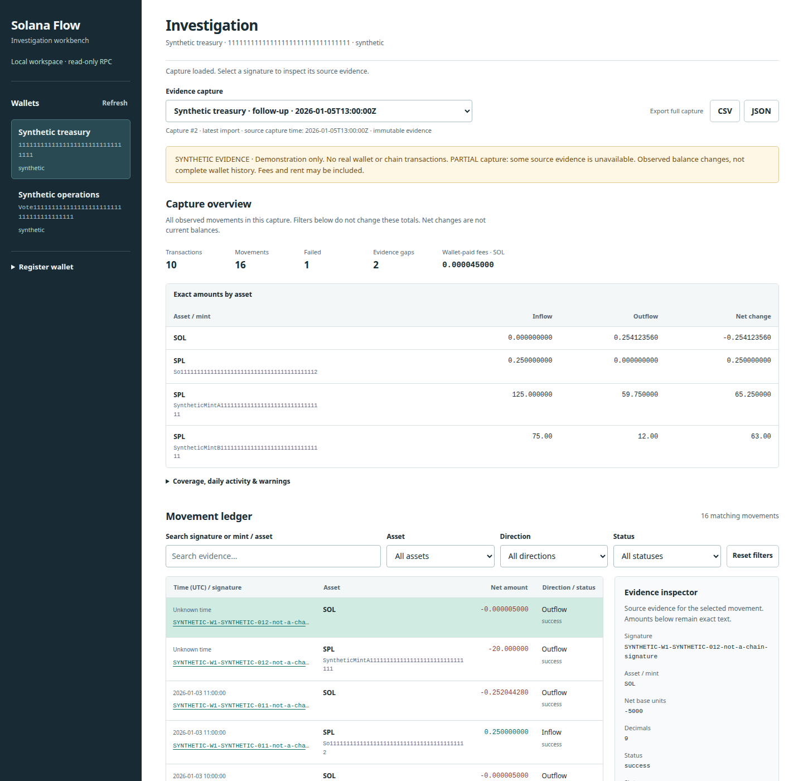

# Solana Flow

**Investigate the evidence, not just the balance.** A local-first, read-only Solana workbench by **gedanut**: capture → immutable SQLite evidence → exact queries → source inspection → capture comparison → export.

[](https://github.com/gedanut/solana-flow/actions/workflows/ci.yml)

Python 3.11+ · zero runtime dependencies · SQLite + HTTP API + browser application · no signing or wallet connection



**[Explore the read-only synthetic workspace](https://gedanut.github.io/solana-flow/explorer/)** · [Portable report demo](https://gedanut.github.io/solana-flow/demo/) · [Architecture](docs/architecture.md) · [Verification](docs/verification.md)

## Start a workspace

```sh
python -m pip install 'git+https://github.com/gedanut/solana-flow.git'
solana-flow serve --database investigation.sqlite3 --demo
# Open http://127.0.0.1:8765/
```

From a checkout, install with `python -m pip install -e .`. Run without `--demo` for an empty workspace. The database remains on your machine; imports, wallets and capture history persist across restarts.

The demo seeds **two synthetic wallets with two overlapping captures each**. Inspect source balance evidence, compare baseline/follow-up captures, filter exact net movements, and export a ledger. All example activity is invented and prominently labeled.

The public explorer uses the same frontend against generated synthetic evidence. It is intentionally read-only: it has no hosted RPC service, database mutation, or pretend live capture. The local application implements those workflows.

## What changed in v2

| Capability | Implementation |
| --- | --- |
| Persistent investigation | Transactional SQLite, wallet identity by address/cluster, immutable normalized captures, SHA-256 deduplication, indexed movements |
| Exact queries and analytics | Parameterized filters/pagination, latest-import scope, integer per-asset/UTC daily totals, mixed-cluster aggregation protection |
| Evidence inspection | Account keys, pre/post balances, per-side ownership, fee evidence, coverage and gaps |
| Capture comparison | Added/removed/changed signatures, including unavailable observations, and exact per-asset net deltas |
| Background jobs | Durable state machine, bounded single-worker queue, exclusive workspace ownership, restart recovery and sanitized failures |
| Expanded discovery | Classic SPL and Token-2022 current-account enumeration, multi-source signature deduplication/caps and source coverage |
| Real local application | Loopback API, same-origin/session-token mutation protection, browser imports, queries, jobs, comparisons and exports |
| Reproducible public proof | Deterministic explorer, Python/Node tests, real HTTP integration, Chromium E2E and CI |

The original deterministic analyzer and self-contained offline report commands remain available.

## Bring your own evidence

```sh
solana-flow fetch Vote111111111111111111111111111111111111111 \
  --rpc-url https://api.devnet.solana.com --cluster devnet \
  --include-tokens --limit 25 --output .local/snapshot.json
solana-flow import .local/snapshot.json --database .local/investigation.sqlite3 --label "Devnet capture"
solana-flow serve --database .local/investigation.sqlite3
```

The Vote program is a public example address, not a private wallet. Cluster is an explicit label, not inferred from endpoint identity. Remove `--include-tokens` for wallet-address references only. Token mode carries a scope warning and can exit `2` after saving usable partial evidence. Public endpoints can rate-limit or prune history.

For background capture, configure `SOLANA_FLOW_RPC_URL` in your environment before starting `serve` (or pass `--rpc-url`). Register an address/cluster and submit a bounded job in the app. The browser never receives the endpoint; it is not persisted in the workspace. Prefer environment configuration for private endpoints because shell arguments can appear in process listings/history.

Headless workflows:

```sh
solana-flow query --database .local/investigation.sqlite3 --asset SOL --direction out --limit 50
solana-flow compare 1 2 --database .local/investigation.sqlite3
solana-flow analyze .local/snapshot.json --output report-dir
solana-flow demo --output report-dir
```

Query/compare emit JSON; IDs are local workspace IDs. Browser exports include the full selected capture, not only filtered rows. API import is capped at 16 MiB including its envelope; CLI snapshot loading permits 128 MiB.

## Accounting and coverage

- **SOL:** wallet post-lamports minus pre-lamports. Wallet-paid fees are separately informative, already included in native change, and never subtracted twice.
- **SPL:** post-balances explicitly owned by the wallet minus pre-balances explicitly owned by it, grouped by mint. Each side uses its historical owner. Wrapped SOL stays separate.
- **Exactness:** Python integers, TEXT base units in SQLite, decimal-string exports and BigInt browser aggregation. No floating-point amount totals or price lookup.
- **Uncertainty:** missing owners/metadata create explicit gaps. Invalid structure, conflicting decimals and conflicting duplicate signatures are rejected. Unknown data is not filled with zero.
- **Discovery:** wallet references plus optional current token-account references. Closed/transferred accounts, prior ownership and provider-pruned activity can be absent. Empty pages never prove complete history.
- **Scope:** latest means highest **imported capture ID** per wallet, avoiding overlap double counting. Different cluster assets are not aggregated. Multi-wallet totals are wallet-scoped observations, not gross transfer volume.

Balance changes can include rent, fees, ownership changes, swaps and burns. This is not payment/tax classification, a current portfolio balance, or authenticated chain evidence. Deltas between overlapping captures are **not incremental cashflow or PnL**. [Methodology](docs/methodology.md) · [Discovery limitations](docs/discovery.md)

## Python API

```python
from solana_flow.workspace import Workspace
from solana_flow.cli import load_snapshot

workspace = Workspace("investigation.sqlite3")
capture = workspace.import_snapshot(load_snapshot("snapshot.json"), label="Evidence")
page = workspace.movements(capture_id=capture["id"], asset="SOL", limit=50)
summary = workspace.analytics(capture_id=capture["id"])
evidence = workspace.get_capture(capture["id"])["snapshot"]
```

`from solana_flow import analyze` remains deterministic and I/O-free. Workspace imports validate, normalize, reanalyze and atomically store evidence. Labels are not part of capture identity. [Workspace contract](docs/workspace.md) · [HTTP API](docs/api.md) · [Jobs](docs/jobs.md)

## Verify and develop

```sh
python -m pip install -e . 'coverage>=7,<8' 'ruff>=0.11,<1' 'build>=1,<2'
coverage run -m unittest discover -s tests -v
coverage report
ruff check . && ruff format --check .
npm ci
npm test
python scripts/generate_explorer.py
npx playwright install chromium
npm run test:e2e
python -m build
```

Node/Playwright are development-only. The installed application needs only Python. Browser tests use disposable workspaces and an explicitly local RPC fixture, not private activity. See [verification](docs/verification.md) for observed checks and limits, and [contributing](CONTRIBUTING.md) for developer details.

## Safety and operation

The service binds only `127.0.0.1`. It is a single-user local tool, **not an internet-facing service**. Host/Origin validation, per-process mutation tokens, strict bounded JSON, allowlisted assets, text-only rendering, formula-safe CSV and restrictive CSP enforce the intended boundary. The database is not encrypted. Protect database/WAL/lock files and never expose the server through a public tunnel.

Exit status: `0` successful scoped output; `1` invalid input/file/usage error; `2` saved partial capture/report/import; `130` interrupted. A signature cap remains disclosed even when it is not a transport failure. Interrupted jobs need explicit resubmission. No continuous daemon or automatic capture schedule is installed.

[Security](SECURITY.md) · [Release notes](CHANGELOG.md) · MIT licensed

Built as an inspectable Python backend, data engineering and on-chain analytics project.
