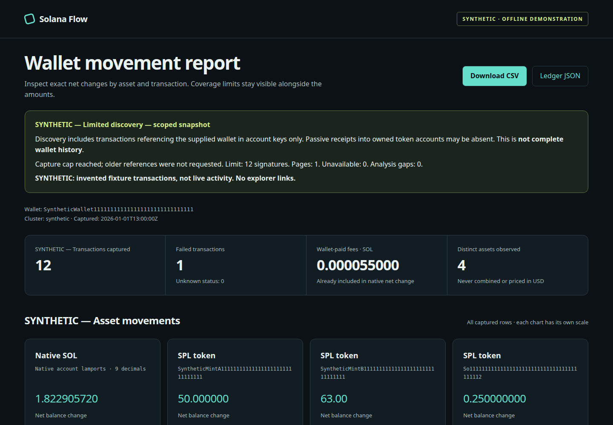

# Solana Flow

**Follow the balance.** A read-only Solana transaction analyzer by **gedanut**: analysis snapshots → exact net movement ledger → CSV, JSON and a self-contained offline HTML report.

Python 3.11+ · zero runtime dependencies · no keys, signing or wallet connection.



[Open the SYNTHETIC demo](https://gedanut.github.io/solana-flow/demo/) · [Methodology](docs/methodology.md) · [Verification](docs/verification.md)

## Try it offline

From this checkout:

```sh
python -m pip install .
solana-flow demo --output report-dir
# Open report-dir/index.html in a browser. No server required.
```

Or, without installing:

```sh
PYTHONPATH=src python -m solana_flow demo --output report-dir
```

Install directly from GitHub:

```sh
python -m pip install 'git+https://github.com/gedanut/solana-flow.git'
# Alternatively:
uvx --from 'git+https://github.com/gedanut/solana-flow.git' solana-flow demo --output report-dir
```

The deterministic demo contains **12 SYNTHETIC transactions and 21 ledger rows**: incoming/outgoing SOL, several token changes, multiple owned accounts, internal movement with net zero, new/closed accounts, a failed transaction with fees, raw versioned keys, ownership change and wrapped SOL. These are invented examples, never live activity. All fixture/report provenance is labeled; synthetic signatures have no explorer links.

## Capture and replay

```sh
solana-flow fetch Vote111111111111111111111111111111111111111 \
  --rpc-url https://api.devnet.solana.com --cluster devnet \
  --limit 25 --output snapshot.json
solana-flow analyze snapshot.json --output report-dir
# Every command also works with: python -m solana_flow
```

This example uses the public Vote program address, not a private wallet. `--cluster` is an explicit label, not inferred from the endpoint. The default `custom` label disables explorer links. Endpoints may have rate limits or unavailable history. Fetch is sequential, finalized, capped at 10,000 unique signatures, with bounded timeouts/retries and cursor-stall detection.

**Discovery only finds transactions referencing the supplied wallet in account keys. Passive transfers into owned token accounts may not reference the owner and can be missing. Token-account enumeration is deferred. This is not complete wallet history.** An empty provider page only establishes a provider boundary. `--limit` is a cap, never a completeness promise.

Exit status: `0` successful scoped output; `1` bad input/file/usage error; `2` a saved partial capture or report with gaps; `130` interrupted. A cap alone is not a transport failure, but remains prominently disclosed. Report files replace existing `index.html`, `ledger.csv`, and `ledger.json`; demo also writes `snapshot.json`.

## What the ledger means

Every row includes signature, slot, nullable block time, status, asset, mint, signed base units, decimals and exact decimal amount. Token mint identifiers are untrusted; no ticker, branding or dollar price is assumed.

- **SOL:** the supplied wallet account’s post-lamports minus pre-lamports. Wallet-paid fees are separately counted, already included in SOL net movement, and never subtracted twice.
- **SPL:** post-balances explicitly owned by the wallet minus pre-balances explicitly owned by it, grouped by mint. Each side uses its own owner; internal movement can net to zero.
- **Uncertainty:** missing owners omit the affected transaction/mint and create a visible gap. Missing token metadata does not erase reliable native data. Malformed indices, duplicate token records, mismatched decimals, conflicting signatures and missing native balance arrays are rejected.
- **Inflow/outflow:** sums of positive/negative net transaction changes, not gross transfer volume. Ownership changes, rent, fees, swaps, burns and wrapped SOL must not be interpreted as payments. This is not tax accounting, income classification or a current portfolio balance.

SOL and every SPL mint stay separate. Charts use an independent scale per asset. Filters affect the ledger table only; summary cards and downloads retain all attributable rows. CSV protects textual identifiers against spreadsheet formulas; JSON preserves their exact original form.

## Python API

```python
from pathlib import Path
from solana_flow import analyze
from solana_flow.cli import load_snapshot
from solana_flow.report import write_report

ledger = analyze(load_snapshot("snapshot.json"))
write_report(ledger, Path("report-dir"))
for asset in ledger["assets"]:
    print(asset["mint"] or "SOL", asset["net"])
```

`analyze` is deterministic and does no I/O. It raises `ValidationError` for malformed inputs and returns explicit `gaps` for incomplete metadata. Amounts remain strings in JSON; calculations use Python integers, independent of floating point or Decimal context precision. Report functions accept the validated result returned by `analyze`.

## Architecture and proof of work

| Module | Responsibility |
| --- | --- |
| `ledger.py` | Schema validation, key resolution, per-side attribution, exact per-asset aggregation |
| `rpc.py` | Two read-only JSON-RPC methods, bounded transport, pagination and coverage |
| `report.py` + packaged assets | Escaped offline HTML, SVG, formula-safe CSV and exact JSON |
| `cli.py` | Validated inputs, safe diagnostics, reproducible outputs and exit semantics |
| `tests/` | Precision, ownership, replay, RPC failures, secret redaction, exports and CLI regressions |

No report network requests, external fonts, trackers or CDNs. Explorer links are explicit user navigation. The HTML carries a restrictive content-security policy with hashes for its bundled script and stylesheet. Captured analysis snapshots retain only allowlisted balance evidence, never the configured RPC URL, provider extensions, instructions, logs or raw server error text. Both RPC and file JSON reject duplicate keys and non-finite constants. A supplied URL can still be visible in shell history/process arguments; use public endpoints for the CLI or construct `RPCClient` from application-managed configuration.

[Development instructions](CONTRIBUTING.md), [security boundaries](SECURITY.md), [schema and methodology](docs/methodology.md), and [actual release checks and remaining environment limitations](docs/verification.md) are included. CI is configured for Python 3.11–3.14; no CI success is claimed before it runs.

MIT licensed. Built as an auditable Python backend and data analytics portfolio project.
