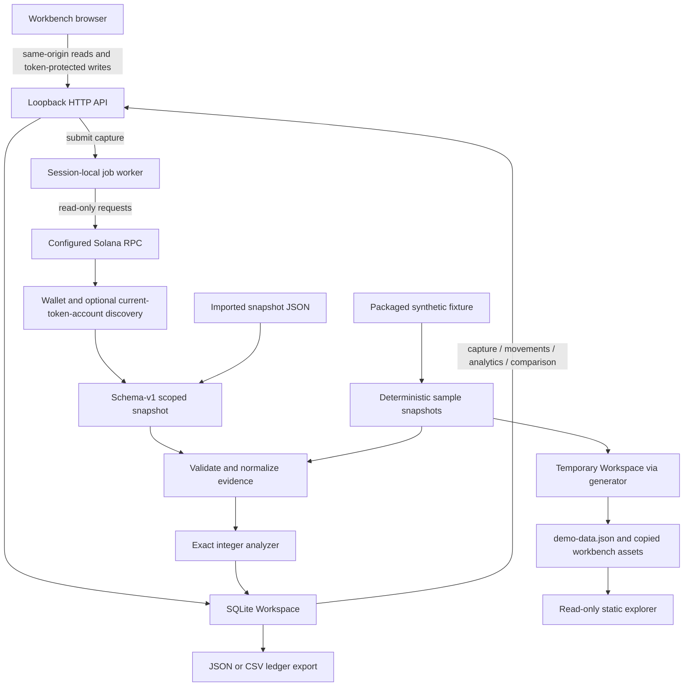

# Architecture: local investigation workbench

Solana Flow stores scoped balance evidence, not a continuously synchronized wallet balance or a complete transaction history. It never signs transactions or requests a private key. The server is a single-user loopback tool, not a publicly deployable API.

## Data paths



Implementation: [workspace.py](../src/solana_flow/workspace.py), [ledger.py](../src/solana_flow/ledger.py), [server.py](../src/solana_flow/server.py), [jobs.py](../src/solana_flow/jobs.py), [discovery.py](../src/solana_flow/discovery.py), and [workbench.js](../src/solana_flow/assets/workbench.js). The [API contract](api.md) documents local HTTP behavior; [methodology](methodology.md) explains balance attribution.

## Persistence and immutable capture semantics

`Workspace(path)` creates a file-backed SQLite database. `PRAGMA user_version` gates the schema; newer unsupported versions are rejected. Each operation opens and closes its own connection, enables foreign keys and WAL, and sets a five-second busy timeout. Imports and job state transitions use transactions; capture import either records all evidence, ledger and movement rows or none of them.

| Table | Identity and contents |
| --- | --- |
| `wallets` | Integer ID; address, cluster, label, creation time. Unique `(address, cluster)`; cluster is an explicit provenance label, not inferred or verified from the endpoint. |
| `captures` | Integer ID, wallet ID, label, evidence capture time, local import time, unique fingerprint, counts, partial/synthetic flags, normalized snapshot JSON and analyzed ledger JSON. |
| `movements` | `(capture_id, row_index)` identity, signature, slot, asset/mint, direction/status, base-unit amount as **TEXT**, full row JSON. |
| `jobs` | Integer ID, wallet ID, status, requested limit/token-discovery flag, optional result capture ID, safe error, creation/update times. |

Import validates the supplied snapshot, strips non-analysis/provider extensions using an allowlist, analyzes the normalized evidence, and fingerprints its canonical sorted JSON using SHA-256. Stored evidence includes balance arrays, account keys, token ownership and available loaded addresses; it is not a complete raw RPC archive. Instructions, logs and arbitrary provider fields are not stored. Coverage storage retains the core `limit`, `pages`, `cap_reached`, `reached_history`, `partial`, `discovery` fields; richer discovery diagnostics are not all retained as structured fields.

A duplicate normalized snapshot returns the existing capture metadata; it does not overwrite that capture or its original label. Capture time and warnings are part of fingerprinted evidence, so recapturing the same transactions with a different capture time can create a new capture. Changing evidence under the same signature is allowed **between separate captures**; conflicting duplicate signatures **within one snapshot** are rejected. There is no capture-edit endpoint.

An import can create its wallet automatically. Adding an already registered `(address, cluster)` returns the existing wallet without changing its label. Default movement/analytics scope uses the greatest capture ID per wallet (latest **import**, not greatest `captured_at`). It does not merge overlapping captures. Selecting `capture_id` selects that one immutable capture; specifying a mismatching wallet is rejected. Workspace-wide totals sum these selected per-wallet views, not a deduplicated economic portfolio: activity appearing in two wallets can be counted in both.

Comparison requires captures from the same wallet record. Added/removed signatures are set differences over available **and unavailable** signatures. Changed signatures compare canonical normalized transaction evidence (including a transition from unavailable to available). Asset deltas subtract capture nets; they do not imply a payment, an incremental period return or a change in current holdings. Differing observation windows alone can change totals.

## Exact amounts, dates and uncertainty

The analyzer uses integer arithmetic and decimal strings. Native SOL and each SPL mint remain separate; wrapped SOL is not merged with native SOL. Inflow sums positive observed net changes, outflow sums magnitudes of negative changes, and net is their sum. Fees already affect native balance changes and must not be subtracted again.

Daily analytics group known block times by **UTC date and asset/mint independently**, preserving exact base-unit strings and decimal precision. Daily `count` counts movement rows for that date/asset, not unique transactions. Unknown-time rows remain in overall totals and contribute to `unknown_time_count`, but are excluded from daily amounts. There are no USD prices, cross-asset aggregate balance, market valuation or investment-return metrics.

Missing `meta` produces an all-assets gap with unknown status. Missing token balance arrays produce an SPL gap. Unknown token ownership suppresses attribution of that entire transaction/mint, not a guessed zero. Missing/invalid transactions are named in `unavailable_signatures`; they are distinct from analyzer gaps. Warnings, unavailable signatures and gaps make effective ledger coverage partial. `cap_reached` separately records bounded discovery: even `partial: false` is not a claim of complete wallet history.

## RPC discovery and job lifecycle

Wallet-only mode delegates to existing wallet-address signature pagination. Optional token discovery queries `getTokenAccountsByOwner` for the Token and Token-2022 programs, unions currently owned account addresses with the wallet address, and round-robins signature discovery under a shared unique-signature cap. Signatures are deduplicated across sources before transaction fetch. Invalid responses, unavailable transactions, stalled pagination and resource bounds produce explicit coverage limits/warnings. Discovery uses finalized provider responses, not cryptographic verification or an atomic cross-request chain snapshot.

**Current accounts are not historical ownership discovery.** Closed accounts, accounts transferred away before discovery, earlier ownership and unsupported extension semantics may be missing. A token-enabled capture carries this warning and remains partial even if every queried source is exhausted. No endpoint chain identity is automatically verified.

The session-local background worker persists `queued → running → succeeded | partial | failed`. Successful/partial terminal jobs reference an imported capture belonging to the same wallet, with matching partial status. Terminal job records cannot be transitioned again. At worker startup, `recover_jobs()` marks abandoned queued/running jobs failed with a restart explanation; it does not silently replay network work. Submit a new job to retry. Run one worker-owning server per database: recovery is a startup operation, not a multi-process scheduler or lease protocol.

The RPC URL is session configuration (`--rpc-url` or `SOLANA_FLOW_RPC_URL`), not stored job metadata. Safe worker errors avoid raw provider error bodies. Provider-controlled identifiers or user labels can still contain sensitive data: allowlisting is not a guarantee that arbitrary imported evidence is safe to publish.

## Local safety boundary

The HTTP server accepts only `127.0.0.1` binding, validates Host/Origin and cross-site fetch headers, and requires a per-process session token for mutation. JSON bodies have strict decoding and a 16 MiB limit. Responses use no-store, nosniff, no-referrer and a restrictive same-origin CSP. There is no CORS-enabled public service, user authentication, TLS termination or remote-access support. Do not reverse-proxy it onto a public interface or treat localhost protections as a multi-user authorization system. Anyone with access to the local workspace files can read evidence.

Read-only RPC capture is the only intended network data source; keys, signing, prices and third-party browser runtime dependencies are absent. Imports and exports expose addresses, signatures, amounts and labels by design. Review private captures before publishing. JSON preserves identifiers losslessly; CSV escapes potentially formula-leading text and spreadsheet numeric auto-conversion remains the reader's responsibility.

## Deterministic synthetic publishing

[samples.py](../src/solana_flow/samples.py) deep-copies the packaged twelve-transaction `data/demo.json`, replaces wallet keys and token-owner references consistently, and returns `sample_snapshots() -> list[tuple[str, dict]]` as `(label, snapshot)` pairs. Two valid base58 wallet identifiers each have a baseline and an overlapping follow-up. These identifiers deliberately refer to system/vote program key encodings **only as synthetic labels**, not evidence of their actual activity. Cluster and all ledger rows remain unmistakably synthetic; signatures are deliberately not real chain signatures.

Follow-ups add/remove observations, correct synthetic transaction 004 token evidence in a new capture, and include unavailable signatures, missing metadata, unknown ownership and unknown time. `seed_workspace(workspace) -> list[dict]` returns normal capture metadata in seed order and is idempotent. No ledger metric is hand-authored.

Run from the repository root:

```sh
python scripts/generate_explorer.py --output docs/explorer
```

The default output is `docs/explorer`. The generator creates a fresh `Workspace` in a `TemporaryDirectory` (honoring Python's configured temporary directory/TMPDIR), seeds it, and emits `{wallets, captures, jobs: []}` with full `get_capture` results. Only publication metadata clocks are normalized: wallet creation to its first fixture capture time and capture import/creation to its fixture capture time. Transaction times and analysis outputs are not rewritten. IDs derive from the fresh database; JSON uses sorted keys and stable encoding. It copies CSS/JS and transforms the workbench HTML to `data-mode="static"`. Repeated runs against unchanged source assets produce byte-identical files. Serve the generated directory over HTTP; static mode is read-only and cannot import, submit capture jobs or contact RPC.
